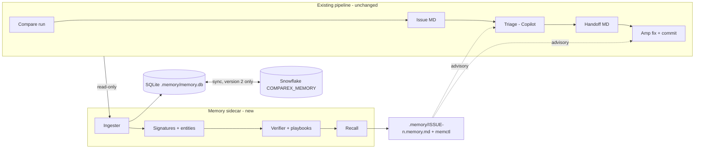

# Comparex Memory Layer — System Design (summary)

Full detail lives in `IMPLEMENTATION_GUIDE.md`. This page is the one-screen view.

## Problem
Comparex compares tables (Snowflake vs SQL Server, SQL Server vs SQL Server) at column level.
Copilot CLI agents turn differences into issue and triage MD files; a handoff MD goes to Amp,
which fixes and commits. Every issue is solved from scratch. The memory layer gives agents the
history: similar past issues, what fixed them, whether the fix was verified, caveats, and the
fastest proven path.

## Architecture

## Key ideas
- **Signature, not text.** Each difference gets L1 (exact: engine pair, category, types, table,
  column), L2 (structural: engine pair, category, type families, value pattern) and L3 (object)
  hashes. Text similarity (TF-IDF + LSA) is only the L4 fallback.
- **Value patterns** (trailing whitespace, tz shift, precision loss, ...) are classified from
  sample values at ingest time by deterministic rules; values are never stored.
- **Verification by Comparex.** A fix passes only if the next compare run no longer shows the
  issue's L1 difference. Partial, fail, reopened and unverified are tracked.
- **Confidence** = recency-weighted, Laplace-smoothed pass rate per (L2, approach).
  Playbooks go candidate → active → retired.
- **Recall** ranks approaches by match level × confidence, picks the fastest proven one, lists
  failed approaches, caveats and entity facts, and writes one memory file per issue.
- **Integration** is one instruction line in the agents' instructions file. Nothing else in the
  pipeline changes.
- **Stack:** Python, SQLite (local), Snowflake (shared, long-term). No LLM, no hosted models.
- **Two phased versions.** Version 1 is SQLite only (Phases 0–7). Version 2 adds Snowflake sync
  as one more phase (Phase 8) on top of a working version 1, behind `snowflake.enabled`.
  Agents always read the local memory files, in both versions.

Interactive version with diagram (claude.ai): https://claude.ai/artifact/HPECybMKZpVjEGofpW3sqz
